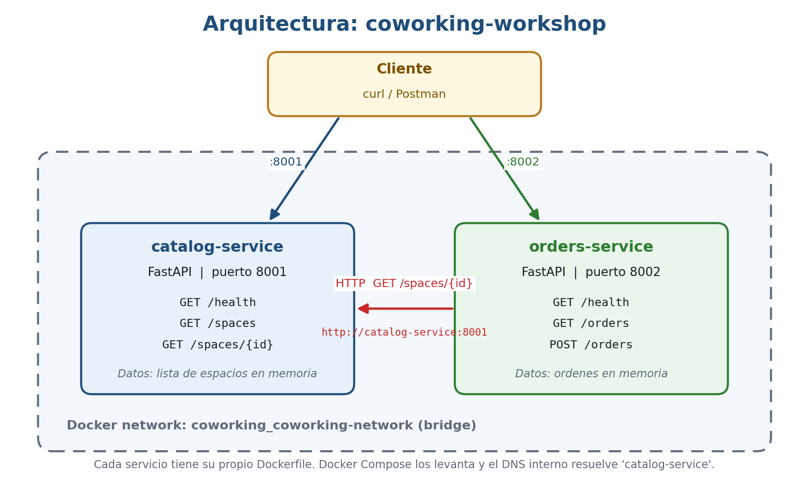

# Coworking Workshop

Taller de microservicios: dos servicios en **FastAPI** que se comunican por HTTP, orquestados con **Docker Compose**, más experimentos de **Chaos Engineering**.



## Servicios

| Servicio | Puerto | Qué hace |
|---|---|---|
| `catalog-service` | 8001 | Expone los espacios de coworking (nombre, capacidad y `price_per_hour`) |
| `orders-service` | 8002 | Crea órdenes; consulta el precio al catálogo por HTTP |

Los dos servicios comparten la red `coworking_coworking-network`. Dentro de ella `orders-service` encuentra al catálogo por su nombre (`http://catalog-service:8001`).

## Requisitos

- Docker Desktop (con Docker Compose)
- `curl` (en PowerShell usar `curl.exe`)
- Opcional: Postman, para la colección incluida

No se necesita Python instalado: cada servicio corre en un contenedor con Python 3.11.

## Cómo ejecutarlo

```bash
docker-compose up --build -d
docker-compose ps
```

Para apagarlo:

```bash
docker-compose down
```

## Endpoints

**catalog-service (8001)**

| Método | Ruta | Descripción |
|---|---|---|
| GET | `/health` | Estado del servicio |
| GET | `/spaces` | Lista de espacios |
| GET | `/spaces/{id}` | Un espacio (404 si no existe) |

**orders-service (8002)**

| Método | Ruta | Descripción |
|---|---|---|
| GET | `/health` | Estado del servicio |
| GET | `/orders` | Lista de órdenes (en memoria) |
| POST | `/orders?space_id=&user_email=&hours=` | Crea una orden |

Ejemplo:

```bash
curl -X POST "http://localhost:8002/orders?space_id=1&user_email=test@example.com&hours=2"
```

Respuesta esperada: una orden con `total_price` 50.0 (25.0 por hora x 2 horas).

## Estructura del repositorio

```
coworking-workshop/
├── README.md
├── docker-compose.yml
├── template.yaml
├── chaos-test.sh
├── chaos-report.md
├── architecture-diagram.png
├── coworking.postman_collection.json
├── catalog-service/
│   ├── main.py
│   ├── requirements.txt
│   └── Dockerfile
├── orders-service/
│   ├── main.py
│   ├── requirements.txt
│   └── Dockerfile
├── lambda-catalog/
│   ├── handler.py
│   └── requirements.txt
├── lambda-consumer/
│   └── handler.py
└── events/
    └── sqs-event.json
```

## Labs realizados

| Lab | Descripción |
|---|---|
| 1 | `catalog-service` con FastAPI |
| 2 | `orders-service` que consulta al catálogo con `httpx` |
| 3 | Docker Compose con red compartida |
| 4 | Chaos Engineering: apagar el catálogo (`chaos-test.sh`) |
| 5 | Chaos Engineering: cambiar el contrato sin avisar |
| 6 | Catálogo como función AWS Lambda con API Gateway y evento `SpaceChanged` en EventBridge (despliegue pendiente) |
| 7 | Consumer Lambda con cola SQS y regla de EventBridge; `orders-service` recibe el evento y responde 409 |

## Chaos Engineering

El detalle de ambos experimentos está en [`chaos-report.md`](chaos-report.md).

| Experimento | Resultado |
|---|---|
| Catálogo apagado | `orders-service` responde `503 Catalog service unavailable`, sigue vivo y se recupera solo al volver el catálogo |
| `price_per_hour` renombrado a `hourly_rate` | `orders-service` falla con `500` (`KeyError: 'price_per_hour'`) aunque ambos servicios estén sanos |

Para repetir el primer experimento (con Git Bash):

```bash
bash chaos-test.sh
```

El contrato del catálogo quedó restaurado en un commit posterior al Lab 5.

## Pruebas con Postman

Importar `coworking.postman_collection.json` en Postman y ejecutar la colección (**Run collection**) con los contenedores levantados. Incluye 9 peticiones y 13 pruebas automáticas, entre ellas la que valida que el campo `price_per_hour` existe en el catálogo.

## Parte 2: Serverless (Labs 6 y 7)

Migración del catálogo a funciones AWS Lambda y comunicación por eventos.

```
API Gateway /catalog -> Lambda catalog-fn -> EventBridge (SpaceChanged)
   -> SQS (catalog-events) -> Lambda consumer-fn -> orders-service
```

### Archivos

| Archivo | Para qué sirve |
|---|---|
| `lambda-catalog/handler.py` | Catálogo como Lambda; al cambiar la disponibilidad publica el evento `SpaceChanged` |
| `lambda-consumer/handler.py` | Lee la cola SQS y reenvía cada evento a `orders-service` |
| `template.yaml` | Plantilla AWS SAM: funciones, API Gateway, cola SQS y regla de EventBridge |
| `events/sqs-event.json` | Mensaje de prueba para ejecutar el consumer en local |

### orders-service y los eventos

`POST /events/space-changed` recibe `{"space_id": 1, "available": false}` y marca el espacio como no disponible. Mientras lo esté, `POST /orders` responde **409 Space not available**. El estado se guarda en memoria y se pierde al reiniciar.

### Estado

- `sam validate` y `sam build` terminan correctamente.
- El consumer se probó en local con `sam local invoke`, enviando el evento a `orders-service` en Docker, y las órdenes del espacio afectado se rechazaron con 409.
- **El despliegue en AWS no se pudo completar**: una service control policy de la cuenta (plan gratuito de AWS) deniega CloudFormation, Lambda, SQS y EventBridge. Se abrió un caso con AWS Support.

### Probar en local

```powershell
sam build
sam local invoke ConsumerFunction --event events/sqs-event.json --parameter-overrides OrdersUrl=http://host.docker.internal:8002
```